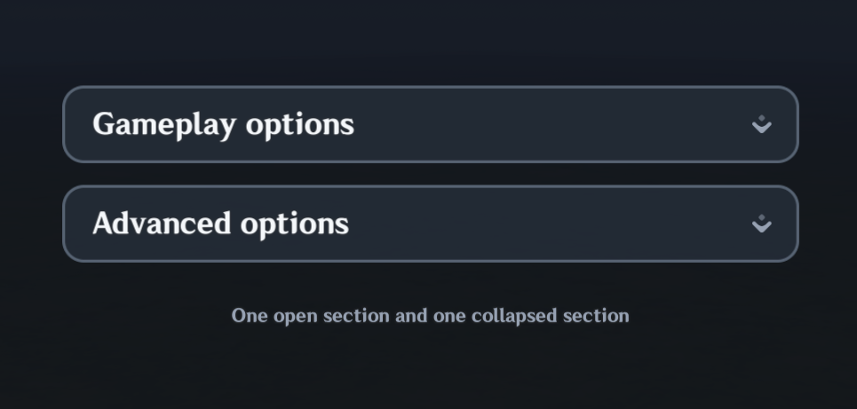
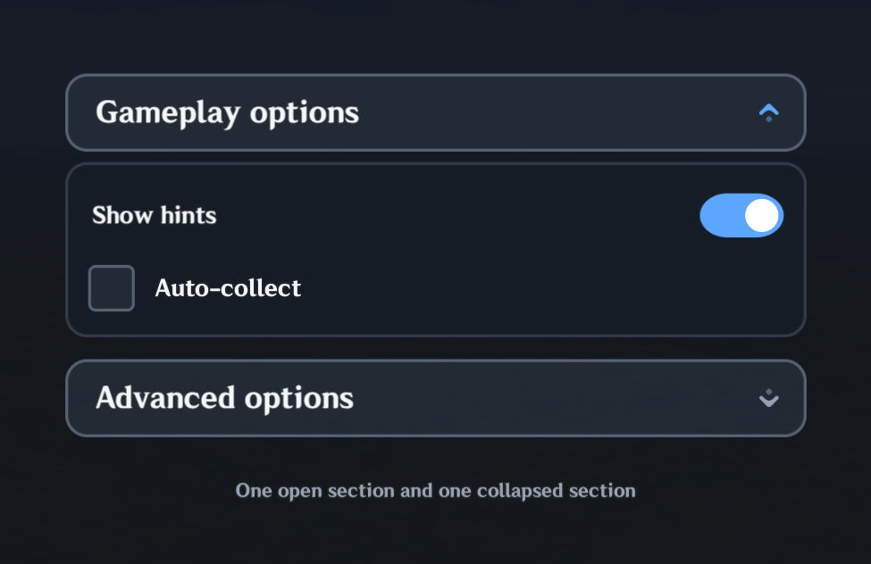

# Accordion

| Both sections collapsed | Gameplay options expanded |
| --- | --- |
|  |  |

`UI.Accordion` creates a section that players can expand or collapse. Its header can receive controller focus, and the section's height adjusts to the controls you put inside it.

Use it for settings groups, advanced options, help sections, patch-note groups, debug panels, and other places where long content should be hidden until requested.

## Basic usage

```lua
local section = UI.Accordion(parent, {
    title = {
        text = "Advanced Settings",
        textId = "Settings.Advanced",
    },
})

UI.Toggle(section.content, {
    label = {
        text = "Controller Hints",
        textId = "Settings.ControllerHints",
    },
    value = true,
    fillWidth = true,
})
```

`section.content` is a fitted vertical Stack. Add normal MiliUI controls directly to it. Its height follows its children automatically, and the Accordion body/root follow that content height without requiring a manual body height.

## Open state

The default state is closed:

```lua
local section = UI.Accordion(parent, {
    title = {
        text = "Details",
        textId = "Details.Title",
    },
    open = false,
})
```

State methods:

```lua
section:SetOpen(true)
section:SetOpen(false)
section:Toggle()

print(section:IsOpen())
```

`GetValue()` and `SetValue(...)` expose the same boolean state for generic state/persistence tooling.

`OnChange` receives the new open state and the Accordion:

```lua
section:OnChange(function(open, accordion)
    print("open", open)
end)
```

Programmatic setters only fire the callback when `fireEvent = true` is supplied. Header clicks fire it normally.

## Remembering open state

Accordion participates in normal Session persistence:

```lua
local section = UI.Accordion(parent, {
    id = "Advanced Settings Section",
    remember = true,
    title = {
        text = "Advanced Settings",
        textId = "Settings.Advanced",
    },
})
```

Inside a registered Page, the remembered ID is scoped to that Page. The Page can be destroyed and rebuilt while the Accordion restores its previous open/closed state.

Remembered IDs must still be unique within their resolved Session scope.

## Header

The header uses the normal MiliUI Button behavior, including controller focus by default.

Useful header props include:

```lua
headerHeight = 56
headerVariant = "secondary"
headerBackground = "surface2"
headerHoverColor = "surfaceHover"
headerPressedColor = "surfacePressed"
headerRadius = "lg"
headerBorder = true
headerBorderColor = "borderStrong"
controllerFocus = true
```

The title accepts a normal localized TextSpec through `title`:

```lua
title = {
    text = "Gameplay",
    textId = "Settings.Gameplay",
}
```

`label` is accepted as an alias.

Change it later with:

```lua
section:SetTitle({
    text = "Gameplay Options",
    textId = "Settings.GameplayOptions",
})
```

## Indicator

The default indicator uses `UI.Theme.assets.chevronDown` (`100105`).

It rotates from `indicatorRotation = 0` to `indicatorOpenRotation = 180` while opening/closing.

Useful props:

```lua
indicatorImage = UI.Theme.assets.chevronDown
indicatorSize = 18
indicatorInset = 18
indicatorColor = "muted"
indicatorOpenColor = "accent"
indicatorDisabledColor = "disabled"
indicatorRotation = 0
indicatorOpenRotation = 180
```

Set `indicatorImage = false` to hide it.

## Body styling

The body is a normal MiliUI Panel around the fitted content Stack:

```lua
local section = UI.Accordion(parent, {
    bodyBackground = "surface",
    bodyBorder = true,
    bodyBorderColor = "border",
    bodyRadius = "lg",

    bodyPadding = 16,
    bodyGap = 10,
    bodyAlign = "stretch",
    bodyJustify = "start",
})
```

Image-backed surface props are also available:

```lua
bodyImage = 107033
bodyStretch = true
bodyBorderImage = 107034
bodyBorderStretch = true
bodyClipToRadius = true
```

## Motion

Animation is enabled by default.

Opening and closing animate the Accordion's actual body height rather than revealing/hiding the full body in one layout jump. A native image mask clips the content while the body grows or shrinks, and the content itself moves a small amount toward its final position. Because the body height changes incrementally, surrounding Stack content moves continuously with the transition instead of snapping before or after the slide.

Configure the opening motion with:

```lua
animate = true
motionDistance = 10
motionDuration = 0.20
```

Disable component motion with:

```lua
animate = false
```

You can also suppress animation for one state change:

```lua
section:SetOpen(true, false, false)
```

## Enabled state

```lua
section:SetEnabled(false)
section:SetEnabled(true)

print(section:IsEnabled())
```

A disabled Accordion leaves its current open/closed state unchanged and disables the header interaction/controller focus.

## Theming

Accordion reads creation-time defaults from:

```lua
UI.Theme.Apply({
    components = {
        accordion = {
            headerVariant = "secondary",
            indicatorOpenColor = "gold",
            bodyBackground = "surface2",
            bodyBorder = true,
        },
    },
})
```

As with the rest of MiliUI, explicit constructor props override component-theme defaults.
