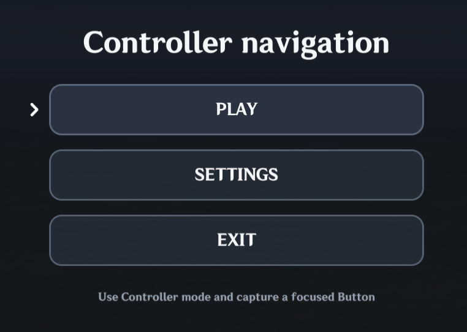

# Controller Support

MiliUI uses Miliastra's built-in controller focus system. **Focus** is the native UI control that will receive Confirm (a Button or a focusable Hitbox). **Selection** is a value your game has chosen, such as the selected menu option. A Button can be selected without being focused, and moving focus does not automatically change your game's selection.

## Controller Navigation V2 (opt-in)

A full-screen menu may opt in to **managed** directional controller navigation. Legacy Screens remain unaffected when the setting is omitted:

```lua
local screen = UI.Screen(hostRoot, {
    controllerNavigation = "auto",
    isolateNavigation = true,
})

local actions = UI.Column(screen.content, { gap = 12 })
local play = UI.Button(actions, {
    label = { text = "PLAY", needsTranslation = false },
    focusKey = "play",
})
local settings = UI.Button(actions, {
    label = { text = "SETTINGS", needsTranslation = false },
    focusKey = "settings",
})

screen:SetInitialFocus(play)
```

Use `UI.Focus.Get(screen)` to look up the **actual native focused target** when it belongs to that managed Screen; `UI.Focus.Set(play)` requests and immediately verifies native focus. It returns `true, "confirmed"` only when `game.GetControllerFocus()` agrees; otherwise it returns `false, reason`. The engine may settle focus later, and the reason `"not-yet-confirmed"` is not proof of permanent failure.

`UI.Focus.Link(play, "Down", settings)` adds a directional override. `UI.Focus.Block(play, "Up")` prevents an intentional exit. `UI.Focus.Refresh(screen)` recomputes after direct native property changes, while `UI.Focus.Explain(screen)` reports focus identity, Host, eligible count and the latest request. Both named logical Pages and Dropdown modals now participate in managed focus coordination. When a Page is rebuilt, provide `focusKey` values to restore logical identity instead of retaining destroyed native handles.

Managed ScrollAreas default their scrollbar arrow buttons to mouse/touch interaction; the controller uses the right stick and a visible focus proxy for scrollable areas with no focusable children. **Right-stick scrolling keeps native focus on the actual Button as long as the Button remains fully visible**. When scrolling moves that Button out of view, the viewport proxy takes focus and its chevron points at the ScrollArea's scrollbar, rather than floating over unrelated content. On an additional right-stick input at the physical boundary, navigation may leave the entire ScrollArea. D-pad and left-stick behavior is unchanged. A single deferred focus check handles native focus changes after a RightStick callback, without any per-frame polling or separate chevron state. During that short scroll-settlement interval the central focus manager retains the current chevron and ignores intermediate native Focus/LostFocus visual changes; after confirming the actual target it releases the hold. This prevents a one-frame chevron flash on neighboring buttons without introducing a second indicator or changing left-stick navigation.

Native Hitbox eligibility can be registered before the public MiliUI wrapper is constructed. ControllerFocus upgrades that early record when final component props arrive, preserving focus keys, wrapper identity, and ScrollArea proxy ownership across later native eligibility notifications.

A managed ScrollArea's focused scrollbar proxy treats **Left as re-entry into its own list**, preferring a visible eligible item, or the nearest offscreen item when the visible tail contains only passive content. If there is no eligible list item, it falls back to normal directional navigation. This is automatic, including nested ScrollAreas; no `UI.Focus.Link` is required. Manual links and blocks continue to override automatic behavior.

Inactive managed Pages register ScrollArea focus subscriptions at construction time, so activation never falls back to raw native Focus events. Re-activating the already active Page preserves an eligible native focus target instead of forcibly resetting it; switching Pages still restores the correct managed focus.

Managed V2 navigation traverses the **actual UI control hierarchy**. It searches sibling controls within the current Row, Column or other container before climbing toward the Screen to find neighboring regions. Eligible descendants define each region's rectangular bounds, and navigation stops at true Screen edges. Explicit `UI.Focus.Link`/`Block` and component-specific policies still take priority. Standalone unmanaged Stacks retain legacy native links; unusual interaction designs may still benefit from manual overrides.

See the [V2 usage guide](ControllerNavigationV2.md), [migration checklist](ControllerNavigationV2Migration.md), and [Menu Control Group example](../examples/ControllerNavigationV2Menu.lua). V2 is native-tested and integrated into development `main`; use a public runtime version that includes it before using these APIs.

The remainder of this document describes the **legacy** controller behavior unless otherwise specified.

## Focusable controls

`UI.Button` and `UI.IconButton` are controller-focusable by default. `UI.Hitbox` is not focusable by default, but `controllerFocus = true` enables controller focus and Confirm. Composed controls such as `UI.Selection` choices and `UI.Dropdown` options opt in automatically. Use `controllerFocus = false` when a focus target must be excluded.

When a focusable Button is created, MiliUI configures native controller navigation in all four directions with:

```lua
Enum.ControllerNavigationMode.NearestControl
```

That works well for simple layouts where the nearest visible control is the intended destination.

A disabled Button is removed from controller focus:

```lua
button:SetEnabled(false)
```

Re-enabling it restores normal interaction and controller focusability.

## Controller Confirm activates Buttons

MiliUI maps Miliastra's native controller `Confirm` navigation event to the Button's normal click path.

This means normal application code stays input-agnostic:

```lua
local playButton = UI.Button(parent, {
    label = {
        text = "PLAY",
        textId = "MainMenu.Play",
    },
    fitContent = true,
})

playButton:OnClick(function()
    StartGame()
end)
```

Mouse click and controller Confirm both reach the same `OnClick` callback.

## Visible selection groups

`UI.Selection` uses controller-focusable choice hitboxes by default, including custom-rendered visuals. Each focused hitbox also shows the shared controller chevron, with `controllerFocusIndicator = false` available to hide it. Moving focus does **not** change the selected item; use Confirm to select it. A focused choice receives the same hover/outline styling as pointer hover, and `updateItem` receives `state.hovered = true` while controller focused.

```lua
local choices = UI.Selection(parent, {
    items = items,
    mode = "single",
    appearance = "segmented",
    selected = 1,
})

-- After the Host/page and its UI have been created:
game.SetControllerFocus(choices.choices[1].hitbox.root)
```

For debugging in Test Play, first inspect `game.GetControllerFocus()`. If it remains `nil` after switching to Controller and restarting the level, the native controller system may not have initialized. Do not equate a missing visual focus indicator with a confirmed missing focus event.

## Controller behavior in Selection and Dropdown

`UI.Selection` explicitly links neighboring tiles and segments in all four directions. Inside a `ScrollColumn`, MiliUI navigates within the current group before following the column into another section, so moving Down in a vertical selector does not immediately escape to the next section.

`UI.Dropdown` moves focus from the trigger into its selected visible option (or first enabled option) when opened with Confirm. Up/Down traverses options and automatically scrolls one row when moving beyond the visible list boundary, without needing to focus the scrollbar arrows. At the actual first or last item, native focus stays on the option. By default the scrollbar arrows accept mouse/touch only (`scrollbarControllerFocus = false`), avoiding navigation traps when a scroll arrow disables itself. Controller Cancel or choosing an option closes the popup and restores focus to its trigger. If mouse/other scrolling pushes a focused option offscreen, focus moves to a visible enabled option. Popup chevrons render in the popup's own overlay.

Hitbox focus indicators use the same `controllerFocusIndicator` settings as Buttons. Only focusable hitboxes receive them. A hitbox's `SetEnabled(true)` does not reset existing directional links when the value was already true.

## Explicit navigation overrides

**Managed V2 Screens ordinarily need no directional links.** A Row, Column, or other container gives the automatic navigator its parent-child structure; moving from a sidebar toward an adjacent content region should work without writing navigation code.

When a design truly requires a non-geometric destination, use the central focus API:

```lua
UI.Focus.Link(navigationButton, "Right", firstSetting)
UI.Focus.Link(firstSetting, "Left", navigationButton)
-- To deliberately prevent movement at a boundary:
UI.Focus.Block(navigationButton, "Up")
```

These overrides win over the automatic hierarchy. **Do not call native `SetControllerNavigation` directly for controls in a managed Screen**: the V2 graph writer owns their native edges and can overwrite unmanaged changes during refresh. Native `SetControllerNavigation` remains appropriate for legacy/unmanaged layouts.

## Deterministic navigation inside a group

You can also make Up/Down ordering explicit:

```lua
firstSetting.root:SetControllerNavigation(
    Enum.ControllerNavigationDir.Down,
    Enum.ControllerNavigationMode.Specified,
    secondSetting.root
)

secondSetting.root:SetControllerNavigation(
    Enum.ControllerNavigationDir.Up,
    Enum.ControllerNavigationMode.Specified,
    firstSetting.root
)
```

Use `NearestControl` when geometry naturally describes navigation. Use `Specified` where the intended destination is part of the interaction design.

Use `None` when movement in a direction should do nothing:

```lua
button.root:SetControllerNavigation(
    Enum.ControllerNavigationDir.Right,
    Enum.ControllerNavigationMode.None,
    nil
)
```

## Programmatic focus

Miliastra can move controller focus directly:

```lua
game.SetControllerFocus(playButton.root)
```

Read the current native focus with:

```lua
local focusedControl = game.GetControllerFocus()
```

MiliUI component wrappers expose their native control through `.root`, so pass the root rather than the wrapper object.

## Focus indicator

Controller-focusable Buttons show MiliUI's controller-focus indicator while focused.

### Visual examples



```lua
UI.Button(parent, {
    label = { text = "OPTIONS", needsTranslation = false },
    controllerFocusIndicator = {
        placement = "right",
        align = "center",
        gap = 10,
    },
})
```

Supported placements are `auto`, `left`, `right`, `top`, `bottom`, `inside-left`, and `inside-right`. Cross-axis alignment is `start`, `center`, or `end`.

Focus chevrons render on a visually higher overlay layer rather than underneath other Buttons. Inside ScrollArea, a **wide, vertically clipped focus mask** sits above the content and scrollbar, following the same scroll offset. It allows focus chevrons to extend beyond the viewport horizontally while clipping at the top and bottom edges. `focusIndicatorOverflow` (default 64 UI units per side) controls the allowed horizontal overhang. Increase it for unusually large custom indicators. Outside ScrollArea, chevrons use the page-level overlay. Explicit `left`/`right` placements sit outside the Button edge, while `inside-left`/`inside-right` remain inset.

For narrow Buttons or localized text, you can opt in to label-aware
collision avoidance while keeping `inside-left`/`inside-right` as the
preferred placement:

```lua
controllerFocusIndicator = {
    placement = "inside-left",
    avoidLabelOverlap = true,
}
```

When the estimated rendered label would overlap the inset chevron, MiliUI
moves the indicator to the matching outside edge for that Button. The decision
is re-evaluated when focus enters, after `button:SetLabel(...)`, and on
Button root resizing. This uses **estimated Unicode glyph widths** because
native Miliastra glyph bounds are not exposed; always visually test large-font,
long localized and wrapped labels. The option defaults to `false` to preserve
explicit inside placement for existing games.

The indicator may also be static:

```lua
controllerFocusIndicator = {
    placement = "left",
    animation = false,
}
```

Or disabled for one Button:

```lua
controllerFocusIndicator = false
```

Inside ScrollArea, the focus overlay scrolls together with its content without requiring a per-frame update. Call `RefreshControllerFocusIndicator()` if an already-focused Button changes its position independently of the ScrollArea's scroll offset (for example, after a manual position change).

## Scrollable controller focus

`UI.ScrollArea` and `UI.ScrollColumn` automatically scroll a newly focused
descendant into view by default. This follows nested Row/Column geometry and
uses a small safe inset, rather than assuming the focused control is a direct
child of the scroll viewport.

```lua
local list = UI.ScrollColumn(parent, {
    width = 480,
    height = 320,
    controllerFocusPadding = 12,
    autoScrollOnControllerFocus = true,
})

-- Explicitly reveal a descendant without changing native focus:
list:ScrollControlIntoView(button.root)
```

In managed Screens, ScrollArea auto-reveal listens to **committed focus changes** from ControllerFocus, not raw native Focus events. This prevents queued or transient Focus events from snapping a right-stick-scrolled list back to a previously visible Button. Explicitly navigating to a new Button still reveals it. Unmanaged ScrollAreas retain their native Focus-event behavior.

The focus overlay shares the content's centered coordinate system and
moves in lockstep with scrolling. It is drawn after the list and scrollbar.
Its rectangular mask spans the viewport height, with configurable horizontal
room beyond the content edges. The Core overlay-layer registry lets focus
indicators find the correct parent without a ScrollArea-specific lookup.

`UI.ScrollColumn` enables main-axis controller navigation across its
focusable children by default, including Buttons nested inside Row groups. Standard Rows and Columns can opt in explicitly:

```lua
local buttons = UI.Row(parent, {
    gap = 12,
    controllerNavigation = true,
})

UI.Button(buttons, { label = { text = "YES", needsTranslation = false } })
UI.Button(buttons, { label = { text = "NO", needsTranslation = false } })
```

In **unmanaged** layouts, `controllerNavigation=true` lets the Stack author native links along its main axis: Up/Down in a Column, Left/Right in a Row. Nested Stacks use groups of focusable controls and prefer cross-axis alignment. Native nearest-control fallback remains available at boundaries.

In a **managed V2 Screen**, Row/Column ancestry is already used by the Screen-level hierarchical navigator. Stack layout contributes structure, but its legacy authored main-axis edges do not override V2 automatically. Offscreen scroll targets stay eligible and reveal on confirmed focus. For directional exceptions, use `UI.Focus.Link` / `UI.Focus.Block`, not native edges.

Disabled, hidden and inactive controls are excluded when the relevant graph refreshes. Use `UI.Focus.Refresh(screen)` after directly changing native visibility, active state, or geometry. `Stack:Batch()` still coalesces large Stack layout changes.

## Miliastra Test Play limitations

On current PC Test Play builds, controller focus only initializes if the level
**starts in Controller mode**. Switching PC to Controller after a level starts
can report Controller from `game.GetDevice()` while native focus remains nil.
The supported testing workaround is to switch to Controller inside Test Play,
then restart the level **without leaving Test Play**. MiliUI cannot repair this
native controller initialization behavior.

Additional native quirks observed in controller mode:

- `game.GetCursorUIPos()` can return an unchanged position even when the
  always-on cursor moves. Do not use it to position controller focus.
- `game.GetUICanvasSize()` reports the safe-area-adjusted controller UI
  canvas, smaller than the full editor viewport. MiliUI uses the reported
  canvas, not guessed multipliers to reconstruct the unavailable outer size.

## Screen navigation isolation

`UI.Screen` exposes Miliastra's native navigation isolation through `isolateNavigation`.

Use it when controller navigation should remain inside that screen/root instead of escaping to unrelated native controls outside it.

For a self-contained full-screen menu or controller test page, use `isolateNavigation = true` so focus cannot leave the MiliUI screen for unrelated native/Genshin UI. Do not force isolation on HUD-style interfaces that should allow normal gameplay input.

## Practical pattern: sidebar enters a panel

A controller-friendly two-region menu can use:

```text
Up / Down      move within the current region
Right          enter the content region
Left           return to the sidebar
Confirm        activate the focused Button
```

In a managed Screen, the hierarchy normally provides these transitions automatically. Test the actual layout before adding explicit overrides; use `UI.Focus.Link` only when the intended destination cannot be inferred from the structure.

For working controller examples, see [the Button and menu examples](../examples/getting-started/README.md).
