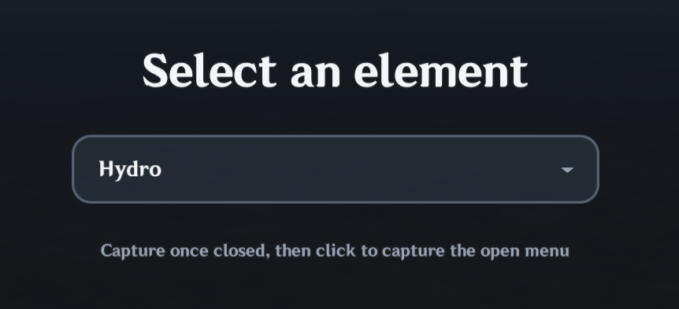
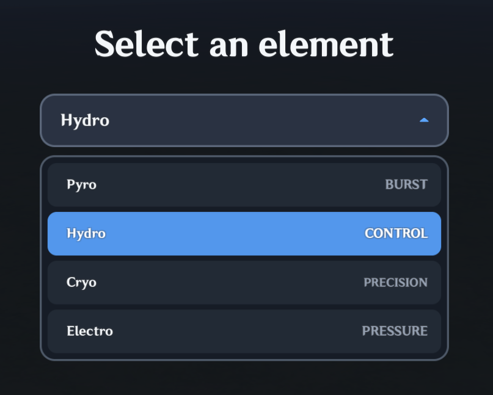

# Dropdown

`UI.Dropdown` lets players choose one item from a dropdown menu. It can scroll long lists, show disabled options, and open above or below the field depending on the available space. Items use Lua's **1-based indexes**, so `selected = 1` chooses the first item.

## Visual example

| Closed dropdown | Open dropdown |
| --- | --- |
|  |  |

These screenshots show one themed example; actual appearance depends on your props and theme.

## Basic usage

`UI.Dropdown` is a collapsible single-item picker; for always-visible segmented or tile choices use [`UI.Selection`](Selection.md).

```lua
local elementDropdown = UI.Dropdown(parent, {
    items = {
        { name = "Pyro", meta = "BURST" },
        { name = "Hydro", meta = "CONTROL" },
        { name = "Cryo", meta = "PRECISION" },
    },
    selected = 2,
    width = 360,
})
```

`GetSelected()` gives you the position of the chosen item in the Lua list, starting at `1`:

```lua
print(elementDropdown:GetSelected())
print(elementDropdown:GetSelectedItem().name)
```

For the example above, those values are `2` and `Hydro`.

## Upgrading from the removed UI.Select API

**`UI.Select(...)` was removed in MiliUI 0.9.0-beta.3.** Older beta.2 examples using that constructor need to use `UI.Dropdown(...)` instead. The current Dropdown supports single selection, disabled options, scrolling, and optional Server Signal submission, as described in this guide.

```lua
-- Old beta.2 constructor, no longer supported:
-- local dropdown = UI.Select(parent, props)

-- Use this in beta.3 and later:
local dropdown = UI.Dropdown(parent, props)
```

See the [beta.3 upgrade checklist](UpgradeBeta3.md#4-replace-uiselect-with-uidropdown) for the migration, and the [complete API reference](Reference/components_dropdown.md) for current properties and methods.

## Item metadata

Every item is an ordinary Lua table. MiliUI reserves only the optional display fields `label`, `name`, `meta`, and `disabled`; other fields are left untouched.

```lua
items = {
    {
        name = "Pyro",
        meta = "BURST",
        elementId = 1,
        amount = 3,
        unlocked = true,
    },
    {
        name = "Hydro",
        meta = "CONTROL",
        elementId = 2,
        amount = 5,
        unlocked = false,
    },
}
```

`GetSelectedItem()` and `onChange` return the original item table, so game-specific metadata remains directly available:

```lua
local select = UI.Dropdown(parent, {
    items = items,
    onChange = function(index, item)
        if item ~= nil then
            print(index, item.elementId, item.amount, item.unlocked)
        end
    end,
})
```

## Selection API

```lua
select:GetSelected()
select:GetSelectedItem()
select:SetSelected(4, true)
select:Clear(true)
```

`SetSelected` is intentionally programmatic. It may select an option that is disabled for player input.

Disabling an already-selected item does not silently clear the selection:

```lua
select:SetItemEnabled(4, false)
```

Disable the complete control with:

```lua
select:SetEnabled(false)
```

## Opening and placement

Dropdown fields participate in normal layout, but the temporary dropdown menu and outside-click backdrop are rendered through a same-Host overlay parent. This lets a Dropdown inside `ScrollArea`, `Accordion`, or another masked container open beyond that container without being clipped.

The portal stays inside the same top-level MiliUI page/root, so normal page destruction and Host teardown still own its lifecycle. Developers do not need to provide a separate overlay parent.

By default, Dropdown chooses whether to open above or below based on available overlay space:

```lua
openDirection = "auto"
```

You can force a direction with `"up"` or `"down"`. `menuMargin` controls the minimum distance from the overlay edge when the menu must clamp into view.

Useful methods:

```lua
select:Open()
select:Close()
select:Toggle()
select:IsOpen()
select:GetOpenDirection()
```

Only one MiliUI Dropdown remains open at a time. Clicking outside the active Dropdown closes it.

When opened with controller Confirm on the trigger, focus moves to the selected visible option (or first enabled option). Press Up/Down to move between enabled choices. **When focus reaches the top or bottom visible item, the next Up/Down automatically scrolls one row and focuses the previous/next hidden choice.** Reaching the actual first or last item retains focus rather than escaping into the scrollbar. Controller Cancel closes the popup and returns focus to the trigger; selecting an option also restores trigger focus when `closeOnSelect` is enabled. A mouse/touch scrollbar may still scroll the list directly; if this hides the current focused option, focus moves to a visible enabled option. Focus chevrons render above the menu using its popup overlay. Set `controllerFocusIndicator = false` to hide them, or supply placement settings.

The scrollbar up/down buttons remain clickable with mouse/touch, but **are not gamepad-focusable by default** (`scrollbarControllerFocus = false`), avoiding focus loss when a button disables itself at the end of scrolling. Set `scrollbarControllerFocus = true` only if your interface deliberately needs controller navigation into those buttons; the recommended gamepad interaction is direct option navigation.

The built-in indicator is `UI.Theme.assets.selectIndicator` (`100111` in the default theme). It rotates while the menu is open. Use `indicatorImage`, `indicatorRotation`, `indicatorOpenRotation`, and the indicator sizing/color props to override it without relying on font glyphs.

## Long lists

Dropdown shows at most eight options by default. A longer list automatically receives the shared `UI.Scrollbar` component with image-backed up/down controls and a draggable thumb.

```lua
local mapSelect = UI.Dropdown(parent, {
    items = maps,
    maxVisibleItems = 5,
})
```

`maxMenuHeight` can impose an additional height cap. MiliUI reduces the number of simultaneously visible rows as needed while keeping at least one visible option.

Long-list scrolling is composed from `UI.Scrollbar` and does not require a `GridScrollerTemplateId` in `UI.InitTemplates`. The returned Dropdown exposes that shared component as `elementDropdown.scrollbar` when scrolling is required.

Useful methods:

```lua
select:IsScrollable()

local firstIndex, lastIndex = select:GetVisibleRange()

select:ScrollBy(1)
select:ScrollBy(-1)
select:ScrollTo(12)
```

`ScrollTo(index)` ensures that item is inside the current visible window without changing the selection.

Opening a Dropdown intentionally ensures the current selection is visible. While the menu remains open, manual scrolling may move that selected item off-screen. Closing and reopening the menu brings the current selection back into view again. Programmatically selecting an off-screen item while open also scrolls enough to reveal the new selection.

The shared scrollbar supports its arrow buttons and thumb dragging. The current Miliastra cursor-event API does not expose a mouse-wheel event, so Dropdown does not invent wheel behavior that the host cannot provide reliably.

### Default scrollbar appearance

The built-in theme uses a subtle dark rectangular rail with a blue interactive thumb:

```text
track image      100001  rectangular fill
track color      surface2
thumb image      106007  light rounded rectangle
thumb color      accent
thumb hover      accentHover
```

The different track/thumb shapes are intentional: the rail stays visually quiet and structural while the movable thumb reads as the interactive element.

## Theming

`Theme.components.dropdown` uses the same properties as the normal constructor. Apply themes before creating the Dropdowns that should use them:

```lua
UI.Theme.Apply({
    components = {
        dropdown = {
            background = "surface2",
            hoverColor = "surfaceHover",
            selectedColor = "accentPressed",
            selectedHoverColor = "accentHover",
            menuBackground = "surface",
            itemColor = "surface2",
            itemHoverColor = "surfaceHover",
            maxVisibleItems = 6,
        },
    },
})
```

Explicit constructor props override theme defaults.

Scrollbar styling has a shared theme section used by both standalone `UI.Scrollbar` controls and Dropdown's internal composition:

```lua
UI.Theme.Apply({
    scrollbar = {
        trackImage = 100001,
        trackColor = "surface2",
        thumbImage = 106007,
        thumbColor = "accent",
        thumbHoverColor = "accentHover",
    },
})
```

For `UI.Dropdown`, precedence is:

```text
Theme.scrollbar
    -> Theme.components.dropdown
    -> explicit Dropdown props
```

That means a project can establish one general scrollbar style and still override one component family or one individual Dropdown.

Dropdown also supports image skins for its composed surfaces:

```lua
UI.Theme.Apply({
    components = {
        dropdown = {
            fieldImage = 107033,
            fieldStretch = true,
            fieldClipToRadius = true,

            menuImage = 107020,
            menuStretch = true,
            menuClipToRadius = true,

            itemImage = 107051,
            itemStretch = true,
            itemClipToRadius = true,
        },
    },
})
```

Available specialized image fields include:

```text
fieldImage / fieldBorderImage
menuImage / menuBorderImage
itemImage / itemBorderImage
scrollbarTrackImage
scrollbarThumbImage
```

The field also accepts the normal surface-style aliases `backgroundImage`, `backgroundStretch`, `borderImage`, `borderStretch`, and `clipToRadius`.

## ServerSignal submission

Dropdown uses scalar ServerSignal parameters because exactly one item is selected. By contrast, `UI.Selection` in multiple mode sends list parameters.

```lua
local submitButton = UI.Button(parent, {
    label = {
        text = "SEND",
        needsTranslation = false,
    },
})

local select = UI.Dropdown(parent, {
    items = {
        {
            name = "Pyro",
            elementId = 1,
            amount = 3,
            unlocked = true,
        },
        {
            name = "Hydro",
            elementId = 2,
            amount = 5,
            unlocked = false,
        },
    },

    submit = {
        signal = "ChooseElement",
        fields = {
            { source = "index", type = "Int" },
            { key = "elementId", type = "Int" },
            { key = "name", type = "String" },
            { key = "amount", type = "Int" },
            { key = "unlocked", type = "Bool" },
        },
    },

    submitButton = submitButton,
})
```

If Hydro is selected, the Server Node Graph must expect these scalar parameters in the same order:

```text
Int     2
Int     2
String  Hydro
Int     5
Bool    false
```

Supported scalar types are:

```text
Int
Float
String
Bool
Guid
Entity
PrefabId
ConfigId
Vector3
```

If `fields` is omitted, the default contract sends only the selected 1-based index as one `Int` parameter.

The submit button is automatically disabled while there is no selection or while the Dropdown is disabled.

For manual control:

```lua
local valid, reason = select:CanSubmit()
local payload = select:BuildSubmitPayload()
local sent, submitReason = select:Submit()

select:OnSubmit(function(index, item)
    print(index, item.name)
end)
```

## Server authority

A ServerSignal sent by a client is still client-provided input. MiliUI validates the local payload shape, but that does not make gameplay-sensitive values authoritative.

Prefer sending a stable ID, ConfigId, or another lookup key and deriving prices, damage, rewards, ownership, or other authoritative values on the server.

For example, this is safer:

```lua
fields = {
    { key = "elementId", type = "Int" },
}
```

than trusting a client-submitted damage or reward amount as the server's source of truth.

## Events

```lua
select:OnChange(function(index, item, control)
end)

select:OnOpen(function(control)
end)

select:OnClose(function(control)
end)

select:OnSubmit(function(index, item, control)
end)
```

`onChange` also accepts `nil, nil` when the selection is cleared.

## Current scope

Dropdown v1 intentionally does not include search/filter input, dynamic `SetItems`, or custom item renderers. Those can be added later if real interfaces require them without complicating the normal dropdown path.
