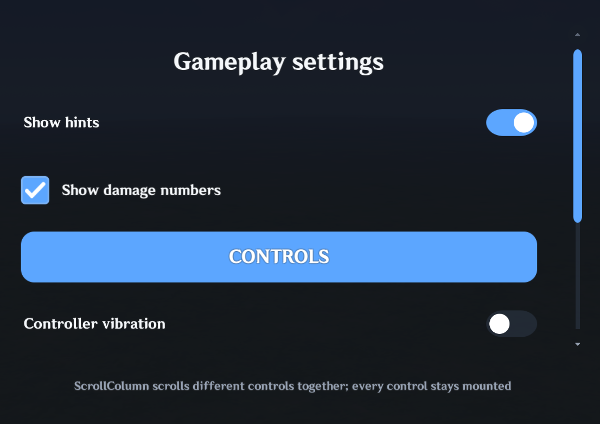
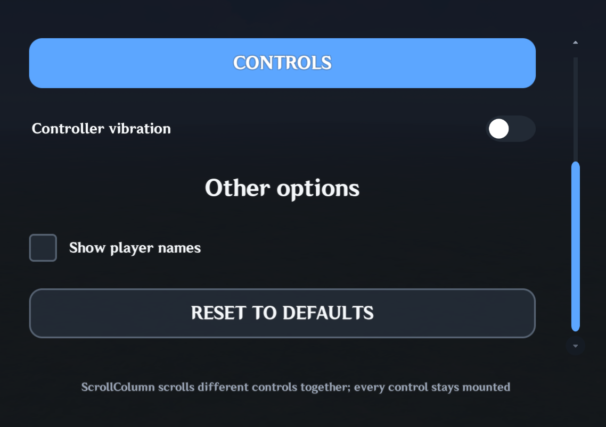

# ScrollArea

`UI.ScrollArea` creates an area that scrolls vertically. You can place Buttons, Cards, and other controls inside it. Anything outside the visible area is hidden, and a scrollbar lets players move through the content.

## Basic usage

### Visual examples

| Example 1 | Example 2 |
| --- | --- |
|  |  |

```lua
local area = UI.ScrollArea(parent, {
    width = 520,
    height = 320,
    contentHeight = 900,
})

UI.Card(area.content, {
    y = 350,
    width = "90%",
    height = 120,
})
```

Create the controls you want to scroll inside `area.content`, not `area.root`. The `content` container is the part that moves when the player scrolls.

`contentHeight` tells MiliUI how tall the **whole list** is, including the part you cannot see. In this example the list is 900 units tall, but the visible area is only 320 units tall. That difference is how far it can scroll.

```text
how far you can scroll = contentHeight - visible area height
```

When the content fits, the scrollbar is hidden and the viewport reclaims the full width. Set `alwaysShowScrollbar = true` if a stable reserved lane is preferred.

## Interactive and nested content

A ScrollArea hides the part of its contents that does not fit. Buttons, Toggles, and other controls inside it still work normally.

For example, buttons, toggles, checkboxes, sliders, Tabs, Dropdowns, Cards, Rows, and Columns can all live under `area.content`:

```lua
local column = UI.Column(area.content, {
    width = "100%",
    height = "100%",
    padding = 16,
    gap = 12,
    align = "stretch",
})

UI.Button(column, {
    fillWidth = true,
    height = 52,
    label = {
        text = "TRACK MISSION",
        needsTranslation = false,
    },
})

UI.Checkbox(column, {
    fillWidth = true,
    height = 52,
    label = {
        text = "Show completed",
        needsTranslation = false,
    },
})
```

You can drag across most Buttons and other clickable controls to scroll the list. A short tap still clicks the control; a drag moves the list instead. The details below explain how that works. This includes Buttons/IconButtons, Toggle, Checkbox, Stepper Buttons, Tabs, Dropdown triggers, Selection choices, PlayingCard, and ordinary `UI.Hitbox` click surfaces.

When a press moves far enough for Miliastra to emit `CursorBeginDrag`, the ScrollArea claims that gesture. MiliUI cancels the child's pending activation and resets its pressed/hover transform before scrolling. Releasing after the drag therefore scrolls instead of accidentally toggling, selecting, opening, or clicking the control that received the original press. A press/release that never becomes a drag remains the control's normal activation.

Drag-owning controls intentionally keep their own gesture. `UI.Slider` keeps horizontal slider dragging and `UI.Scrollbar` keeps thumb/arrow interaction rather than moving an ancestor ScrollArea. Custom `UI.Button` and `UI.Hitbox` controls can make the same choice with `parentScroll = false`:

```lua
local dragSurface = UI.Hitbox(area.content, {
    width = 240,
    height = 80,
    parentScroll = false,
})
```

Focusable Buttons and click Hitboxes that participate in parent scrolling also let the containing ScrollArea consume Right Stick scrolling while they are focused.

Nested ScrollAreas are supported when a real interface needs independent inner and outer scroll regions. Use nesting deliberately; one ScrollArea is easier to navigate when the design does not genuinely need independent scroll regions.

### Controller Navigation V2

If your Screen has `controllerNavigation = "auto"` (available in beta.4 and later), use the **left stick or D-pad** to move between Buttons and the **right stick** to scroll the current list. If the focused Button scrolls out of view, the focus arrow appears beside that list's scrollbar. Press **Left** to return to a Button in the same list. This also works with lists inside or next to other lists.

Passive content after the last selectable item remains right-stick scrollable. An extra right-stick input at the physical top/bottom may exit the region. Auto-reveal reacts to confirmed focus changes only, preventing temporary native Focus events from resetting the scroll position.

Managed ScrollArea scrollbar arrows are mouse/touch targets by default, not separate controller focus buttons. Legacy unmanaged behavior is unchanged. See the [Controller Navigation V2 guide](ControllerSupport.md#upgrading-an-existing-menu) and its [troubleshooting section](ControllerSupport.md#troubleshooting).


## Coordinate model

Scroll offsets are measured downward from the top of the logical content:

```lua
area:GetScrollOffset()      -- 0 at the top
area:GetMaxScrollOffset()   -- bottom-most offset
area:GetScrollRatio()       -- normalized 0..1
```

Programmatic scrolling:

```lua
area:ScrollBy(80)
area:ScrollTo(240)
area:ScrollToRatio(0.5)
area:ScrollToStart()
area:ScrollToEnd()
```

Pass `true` as the final argument when a programmatic call should fire `onScroll` / `OnScroll`:

```lua
area:ScrollTo(240, true)
```

Arrow buttons use `scrollStep`, which defaults to 48 UI units.

## Dynamic content height

If content grows or shrinks at runtime, update the logical height:

```lua
area:SetContentHeight(1200)
```

The viewport width, scrollbar range, and thumb length are recalculated automatically. If the current offset is beyond the new range, it is clamped.

For normal responsive composition, put a persistent layout inside `area.content`:

```lua
local column = UI.Column(area.content, {
    width = "100%",
    height = "100%",
    gap = 12,
    padding = 16,
})
```

When `SetContentHeight(...)` changes the content container size, MiliUI refreshes percentage/fill descendants so layout roots such as `Column` can reflow.

Keep `contentHeight` accurate. If it is smaller than the actual arranged content, the bottom items may legitimately overflow the logical content container and diagnostics can report that mistake.

## Shared scrollbar

`area.scrollbar` is a normal `MiliUI.Scrollbar`. The default appearance comes from `UI.Theme.scrollbar`:

```lua
UI.Theme.Apply({
    scrollbar = {
        trackImage = 100001,
        trackColor = "surface2",
        thumbImage = 106007,
        thumbColor = "accent",
        thumbHoverColor = "accentHover",
    },
})
```

ScrollArea-specific overrides use the `scrollbar...` prefix:

```lua
local area = UI.ScrollArea(parent, {
    contentHeight = 900,
    scrollbarWidth = 28,
    scrollbarThumbWidth = 12,
    scrollbarThumbColor = "success",
})
```

The shared theme remains the fallback because ScrollArea delegates the actual scrollbar to `UI.Scrollbar`.

## Clipping and viewport shape

The viewport uses native `ImageControl` masking. Square clipping is the default.

For rounded clipping:

```lua
local area = UI.ScrollArea(parent, {
    width = 520,
    height = 320,
    contentHeight = 900,
    viewportRadius = "lg",
})
```

You can also supply a custom opaque mask asset with `maskImage`.

Because overflow beneath an active native mask is intentional and visually clipped, `UI.CheckLayout(...)` does not report a direct child merely for extending beyond a masking parent. Descendants are still checked normally against their own layout parents.

## Events and state

```lua
area:OnScroll(function(offset, ratio, control)
    print(offset, ratio)
end)

area:SetEnabled(false)
area:SetEnabled(true)
```

Disabling the ScrollArea disables scrollbar interaction but does not hide or reposition content.

Useful exposed controls:

```lua
area.root
area.viewport
area.content
area.scrollbar
```

## Current scope

The current ScrollArea is vertical only and uses an explicit logical `contentHeight`. It does not attempt automatic descendant measurement, mouse-wheel input, inertial scrolling, or horizontal scrolling. Those can be added later if the Miliastra host exposes reliable input support and real interfaces need them.
