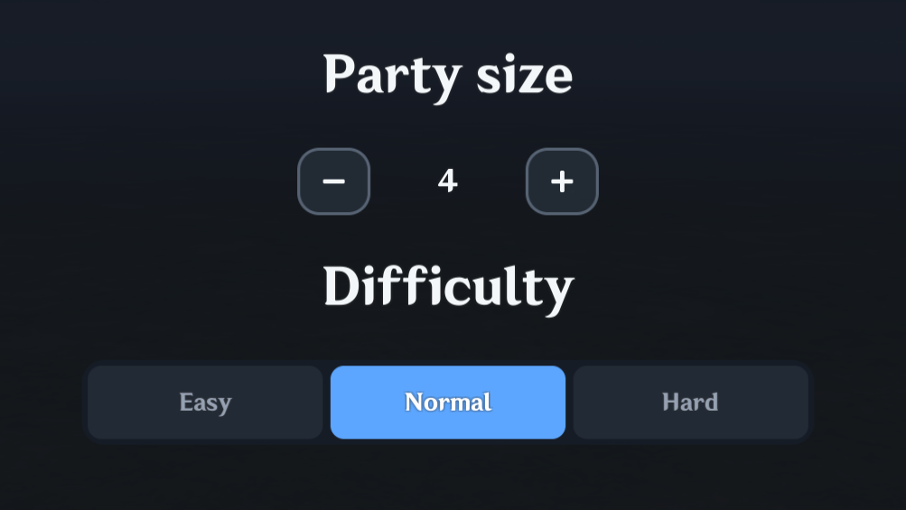
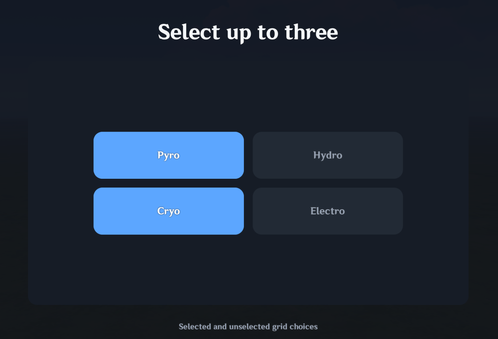

# Selection

`UI.Selection` lets players pick one or several items from a visible collection. You can limit how many items they select, change how each item looks, and optionally send the selection to a Server Signal. Items use Lua's **1-based indexes**, so the first item is `1`, not `0`.

MiliUI handles clicks, controller focus, highlighting, selection limits, and item positioning. Use the default item appearance for a basic list, or supply your own item design for something like collectible cards.

## Visual examples

| Segmented selection | Multiple-choice tiles |
| --- | --- |
|  |  |

The screenshots show two configurations of `UI.Selection`. The Stepper at the left of the first screenshot is a separate component.

## Selection modes and appearances

By default, Selection behaves as a multiple-selection grid with the familiar array-based API. Use `mode = "single"` to switch to one selected item. Clicking another item replaces the previous selection without an intermediate empty state.

```lua
local editorItems = UI.Selection(parent, {
    items = items,
    mode = "single",
    selected = 1,
    renderItem = BuildEditorItem,
    updateItem = UpdateEditorItem,
})

editorItems:OnChange(function(index, item)
    ShowEditor(item)
end)
```

Single mode defaults to `required = true`: when no initial item is specified, the first enabled item is selected. Clicking the active item, clearing the selection, or deselecting the last item leaves it selected. Set `required = false` to permit an empty selection (with the default `minimumSelected = 0`). `GetSelected()` returns one 1-based index or `nil` in single mode, but an ascending integer array in multiple mode. `GetSelectedItem()` returns the first selected item table or `nil`.

The compact segmented appearance is a preset of the same component:

```lua
UI.Selection(parent, {
    items = items,
    mode = "single",
    appearance = "segmented",
    selected = 2,
    width = 428,
    height = 60,
})
```

Segmented appearance distributes choices evenly across the available width. Use `columns = 1` and a taller height for a vertical selector, or `columns` / `rows` for a different arrangement.

Multiple mode can keep its minimum enforced with `enforceMinimum = true` (otherwise the minimum applies only to submission). At the maximum, `overselect = "deny"` preserves the current behavior; `"replaceOldest"` and `"replaceNewest"` automatically remove another selected item. Single mode always replaces the previous item.

Single-mode `onChange(index, item, control)` and `onSubmit(index, item, control)` callbacks receive a scalar index and item (or `nil` when optional and cleared); multiple-mode callbacks receive arrays of indices and items. Single-mode ServerSignal submissions use scalar fields such as `Int`; multiple mode sends the matching list parameters such as `IntList`.

## Basic selection

```lua
local choices = UI.Selection(parent, {
    items = {
        { name = "Pyro" },
        { name = "Hydro" },
        { name = "Cryo" },
        { name = "Electro" },
    },

    selected = { 1, 3 },
    minimumSelected = 1,
    maximumSelected = 3,

    columns = 2,
    itemWidth = 220,
    itemHeight = 72,
    gap = 12,
    padding = 16,
})

choices:OnChange(function(indices, items)
    print(indices[1])
    print(items[1].name)
end)
```

Multiple-mode selections always use stable **1-based item indices**. Returned indices are sorted in ascending item order, not click order.

If the player clicks item 5, then 2, then 4, MiliUI returns:

```lua
{ 2, 4, 5 }
```

That deterministic order is also used for submitted metadata so parallel ServerSignal lists remain aligned.

## Item data

Each item is an ordinary Lua table. `label` and `name` are understood by the built-in renderer, while any other fields are preserved as game metadata.

```lua
local items = {
    {
        name = "Pyro",
        amount = 3,
        unlocked = true,
        rarity = 4,
    },
    {
        name = "Hydro",
        amount = 5,
        unlocked = false,
        rarity = 3,
    },
}
```

This metadata can be read in `OnChange`, custom renderers, or an automatic submit schema.

## Grid layout

The component uses a normal cell grid. You can define columns, rows, or let MiliUI derive the column count from available width.

Fixed columns:

```lua
UI.Selection(parent, {
    items = items,
    columns = 3,
    itemWidth = 220,
    itemHeight = 90,
    gapX = 12,
    gapY = 12,
    padding = 16,
    align = "center",
    verticalAlign = "center",
})
```

Auto-wrap:

```lua
UI.Selection(parent, {
    items = items,
    autoWrap = true,
    itemWidth = 220,
    itemHeight = 90,
    gap = 12,
    padding = 16,
})
```

With auto-wrap, resizing the available width can change the resolved grid without changing item definitions. For `appearance = "segmented"`, the default is one evenly divided horizontal row. Override `columns = 1` for a vertical stack, specify another column count for a segmented grid, or set `autoWrap = true` for wrapping. Segmented cells share the available inner area; `itemWidth` and `itemHeight` are calculated from the resolved rows and columns.

Use `GetLayoutInfo()` when you need to inspect the resolved grid.

## Selection limits

By default, `minimumSelected` is a **submit requirement**, not a rule that prevents temporary invalid state. Set `enforceMinimum = true` to enforce it during selection changes.

```lua
minimumSelected = 2,
maximumSelected = 4,
```

The player may clear the list and temporarily have zero selected items. `CanSubmit()` then returns `false` with a reason until the minimum is met.

In multiple mode, `maximumSelected` is a hard interaction limit. `overselect = "deny"` (default) ignores attempts to exceed it; `"replaceOldest"` evicts the earliest selected item, while `"replaceNewest"` evicts the most recently selected. `GetSelected()` still returns indices in item order, not selection history. In single mode the maximum is always one and selecting a different item atomically replaces the previous one.

Useful methods:

```lua
choices:GetSelected()
choices:GetSelectedItems()
choices:GetSelectionCount()
choices:IsSelected(index)
choices:SetSelected({ 1, 3, 5 }, true)
choices:Select(index, true)
choices:Deselect(index, true)
choices:Toggle(index, true)
choices:Clear(true)
choices:SelectAll(true)
choices:CanSubmit()
```

`SelectAll()` selects enabled choices only, in ascending order, up to `maximumSelected`; when enforcing a positive minimum, it will not replace the existing selection with too few enabled items.

## Disabled choices

Disabled means **the player cannot interact with the choice**. It does not prevent Lua from changing selection state.

```lua
choices:SetItemEnabled(2, false)

-- Still valid programmatic operations:
choices:Deselect(2, true)
choices:Select(2, true)
choices:Toggle(2, true)
```

Disabling an already-selected item does not silently remove it from the selection. This makes state changes explicit and predictable.

## Styling simple items with `itemStyle`

For normal list or tile selectors, use the built-in renderer and configure the visual states through `itemStyle`.

```lua
UI.Selection(parent, {
    items = items,

    itemStyle = {
        background = "surface2",
        hoverBackground = "surfaceHover",
        selectedBackground = "accentPressed",
        selectedHoverBackground = "accentPressed",

        textColor = "muted",
        hoverTextColor = "text",
        selectedTextColor = "white",

        border = true,
        borderColor = "border",
        hoverBorderColor = "borderStrong",
        selectedBorderColor = "accent",

        radius = "lg",
        hoverScale = 1.02,
        pressScale = 0.98,
    },
})
```

If `selectedBackground` is explicitly set but `selectedHoverBackground` is omitted, MiliUI keeps the selected background while hovered instead of unexpectedly falling back to the global accent-hover color.

Explicit flat props such as `selectedColor` still work and remain authoritative over grouped `itemStyle` values.

## Image-backed items and rounded clipping

Arbitrary texture assets are usually rectangular. If an image-backed selection item also uses rounded corners, use `clipToRadius = true` so the texture is actually masked to the rounded silhouette.

```lua
itemStyle = {
    backgroundImage = 107033,
    backgroundStretch = true,

    radius = "xl",
    clipToRadius = true,

    border = true,
    borderColor = "borderStrong",
    selectedBorderColor = "white",
}
```

This uses Miliastra's native ImageControl masking internally. See [Masking.md](Masking.md) for direct `UI.Image` masking and the current `reverseMaskArea` host limitation.

## Fully custom item visuals

Use `renderItem` when an item needs more than a label: cards, images, badges, weapon tiles, character portraits, modifiers, map choices, shop items, or similar compositions.

```lua
local function BuildChoice(parent, item, index, state)
    local card = UI.Card(parent, {
        width = "100%",
        height = "100%",
    })

    UI.Heading(card.content, {
        text = item.name,
        needsTranslation = false,
        y = 22,
        width = "88%",
        height = 34,
        size = 18,
    })

    UI.Caption(card.content, {
        text = "Amount: " .. tostring(item.amount),
        needsTranslation = false,
        y = -22,
        width = "88%",
        height = 25,
        size = 12,
    })

    return card
end
```

Then react to state changes with `updateItem`:

```lua
local function UpdateChoice(card, item, index, state)
    if not state.enabled then
        card.background.imageColor = UI.Theme.colors.surfaceDisabled
    elseif state.selected then
        card.background.imageColor = UI.Theme.colors.accentPressed
    elseif state.hovered then
        card.background.imageColor = UI.Theme.colors.surfaceHover
    else
        card.background.imageColor = UI.Theme.colors.surface2
    end
end

local choices = UI.Selection(parent, {
    items = items,
    renderItem = BuildChoice,
    updateItem = UpdateChoice,
})
```

The custom renderer does **not** need to create its own selection hitbox. MiliUI still owns clicking, hover, limits, controller focus, and selection state around the custom visual.

For consistent geometry, custom root visuals should normally fill their cell:

```lua
width = "100%",
height = "100%",
```

## Controller navigation

Each choice is controller-focusable by default (`controllerFocus = true`), including custom renderers. A focused choice displays the shared chevron; configure `controllerFocusIndicator` to adjust its placement, or set it to `false` to hide the chevron. Moving controller focus highlights the focused choice but does not change the selected value; press Confirm to select it. Inside `ScrollArea` or `ScrollColumn`, focus should also scroll an offscreen choice into view. `controllerFocus = false` disables controller focus for the choice hitboxes.

Neighboring choices have explicit directional links in their resolved grid. Within a `ScrollColumn`, Up/Down travels inside the current group before proceeding to another section. On gamepad, moving focus does not change selection until Confirm is pressed.

Controller focus must first be initialized by Miliastra. On PC Test Play, start the level in Controller mode; see [Controller Support](ControllerSupport.md) for current engine initialization limitations. To inspect or set focus explicitly, use `game.GetControllerFocus()` or `game.SetControllerFocus(choices.choices[1].hitbox.root)` after creating the UI.

## Automatic ServerSignal submission

A Selection can optionally define a ServerSignal contract once and aggregate selected item fields automatically.

```lua
local choices = UI.Selection(parent, {
    items = {
        { name = "Pyro", amount = 3 },
        { name = "Hydro", amount = 5 },
        { name = "Cryo", amount = 2 },
    },

    submit = {
        signal = "SubmitLoadout",
        fields = {
            { source = "index", type = "Int" },
            { key = "name", type = "String" },
            { key = "amount", type = "Int" },
        },
    },
})
```

Selecting items 1 and 3 produces parameters in this exact order:

```text
IntList    { 1, 3 }
StringList { "Pyro", "Cryo" }
IntList    { 3, 2 }
```

The Server Node Graph signal must declare matching parameter types in the same order:

```text
SubmitLoadout(
    IntList ids,
    StringList names,
    IntList amounts
)
```

Supported per-item schema types are:

```text
Int
Float
String
Bool
Guid
Entity
PrefabId
ConfigId
Vector3
```

This example uses multiple mode, so MiliUI aggregates each selected field into a matching `*List` ServerSignal parameter. In `mode = "single"`, the same field schema produces scalar parameters instead (for example, `Int`, `String`, and `Int`).

## Previewing before sending

Use `BuildSubmitPayload()` when you want to inspect the local payload without contacting the server.

```lua
local payload = choices:BuildSubmitPayload()

for _, parameter in ipairs(payload.parameters) do
    print(parameter.type, parameter.values or parameter.value)
end
```

Actual submission happens through:

```lua
choices:Submit()
```

or by binding an existing MiliUI Button:

```lua
choices:SetSubmitButton(submitButton)
```

You can also listen locally:

```lua
choices:OnSubmit(function(indices, selectedItems)
    print("Submitting", #indices, "choices")
end)
```

## Client/server trust boundary

**Do not treat client-submitted values as authoritative just because MiliUI serialized them correctly.**

A client can potentially fabricate or alter values before sending a ServerSignal. For sensitive gameplay state, prefer submitting a stable identity such as an item index, GUID, ConfigId, or another server-recognized ID, then have the server look up the authoritative properties itself.

For example, this is convenient but should not be trusted for economy or competitive logic:

```lua
{ key = "price", type = "Int" }
```

A safer authoritative pattern is:

```lua
fields = {
    { key = "configId", type = "ConfigId" },
}
```

Then the server validates the selected IDs and determines the real price, damage, reward, ownership state, or other sensitive values from server-side data.

Sending names, labels, colors, amounts, or other metadata directly is still useful when the values are informational, cosmetic, already validated elsewhere, or intentionally client-owned.

## Theming

Simple item styling can be configured globally through the component theme:

```lua
UI.Theme.Apply({
    components = {
        selection = {
            itemStyle = {
                background = "surface2",
                hoverBackground = "surfaceHover",
                selectedBackground = "accentPressed",
                border = true,
                borderColor = "border",
                selectedBorderColor = "accent",
                radius = "lg",
            },
        },
    },
})
```

As with the rest of MiliUI, theme values are creation-time defaults and explicit constructor props remain authoritative.

## Common use cases

Selection works well for:

- character or class selection;
- map voting;
- modifier decks;
- loadout or weapon choices;
- reward selection;
- perk selection;
- shop or inventory picks;
- difficulty modifiers;
- elemental targets;
- any checkbox-like list where each item needs richer presentation.

Use `itemStyle` for ordinary tiles and `renderItem` / `updateItem` only when the visual really needs a custom composition.

## Related docs

- [Components](Components.md): examples of the main MiliUI components
- [Masking](Masking.md): image masks and rounded corners with `clipToRadius`
- [Theming](Theming.md): default component styles
- [Common Mistakes](CommonMistakes.md): help with layout, selection, and Server Signals
